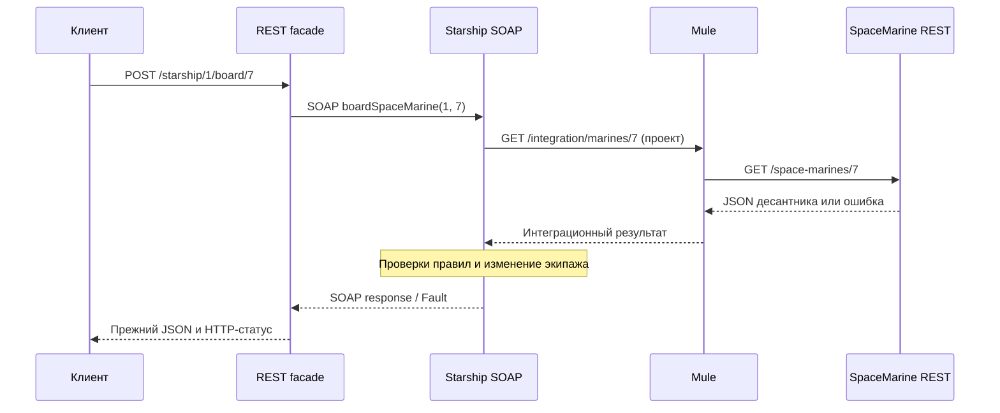

# ЛР4: теория для защиты по шести вопросам

Фактическая реализация и проверенные версии стенда: [LAB4.md](LAB4.md). Примеры ниже объясняют теорию; deploy-конфигурация хранится в `mule/` и `scripts/remote/`.

Основание: [задание и условия](LAB4.md), [скрин преподавателя](docs/photo/task4.png). Это конспект и проектные примеры, **не отчёт о выполненном развёртывании**. Версия и редакция Mule ещё подбираются; работоспособность на Helios не подтверждена.
Примеры в синтаксисе Mule 4 объясняют механизм, но не фиксируют выбор runtime для ЛР4. Первичные источники проверены через web; ссылки приведены рядом с соответствующей теорией.

```text
ПЛАН ЛР4:
Клиент ── прежний REST/JSON ──> REST facade ── SOAP/XML ──> Starship
                                                            │ бизнес-логика
                                                            ▼
                                                          Mule
                                                            │ прежний REST
                                                            ▼
                                                        SpaceMarine
Клиент ── прежние прямые REST-запросы ────────────────────────┘
```

SpaceMarine сохраняет API, протокол и WildFly; SOAP-сервисом становится Starship. Размещение facade, HAProxy и контракт Starship → Mule пока уточняются. В примерах ниже внутренний HTTP/JSON-вход Mule — **предлагаемый вариант**, не существующий endpoint.

## 1. SOAP: особенности, отличия от REST, преимущества и недостатки

**Короткий ответ:** SOAP — протокол обмена XML-сообщениями с формальными правилами обработки. REST — архитектурный стиль; сравниваются разные уровни, а не два формата сериализации.
SOAP задаёт оболочку сообщения, REST — ограничения организации взаимодействия.

### Структура сообщения и версии

`Envelope` — корень; необязательный `Header` предшествует обязательному `Body`. В Header помещают служебные блоки, в Body — прикладные данные либо Fault. `mustUnderstand` требует от адресата блока обработать его по правилам SOAP или сообщить ошибку.
XML namespace определяет смысл имени; замена префикса `s` на `soap` смысл не меняет. Источник: [W3C SOAP 1.2, модель обработки и структура](https://www.w3.org/TR/soap12-part1/).

| Свойство | SOAP 1.1 | SOAP 1.2 |
|---|---|---|
| Namespace Envelope | `http://schemas.xmlsoap.org/soap/envelope/` | `http://www.w3.org/2003/05/soap-envelope` |
| Тип содержимого для HTTP | `text/xml` | `application/soap+xml` |
| Указание действия | Заголовок `SOAPAction` | Параметр `action` типа содержимого, если используется |
| Основные поля Fault | `faultcode`, `faultstring`, `detail` | `Code`, `Reason`, `Detail` |
| Ошибка отправителя / получателя | `Client` / `Server` | `Sender` / `Receiver` |

Версии нельзя смешивать: namespace, HTTP-заголовки и Fault должны соответствовать binding. Источники: [SOAP 1.1](https://www.w3.org/TR/2000/NOTE-SOAP-20000508/), [SOAP 1.2 HTTP binding](https://www.w3.org/TR/soap12-part2/).

Учебный запрос посадки; адрес, namespace и SOAPAction предложены для объяснения:

```http
POST /soap/starship HTTP/1.1
Host: starship.example.test
Content-Type: text/xml; charset=utf-8
SOAPAction: "urn:soa:starship:boardSpaceMarine"

<s:Envelope xmlns:s="http://schemas.xmlsoap.org/soap/envelope/"
            xmlns:t="urn:soa:starship">
  <s:Body>
    <t:boardSpaceMarine>
      <t:starshipId>1</t:starshipId>
      <t:spaceMarineId>7</t:spaceMarineId>
    </t:boardSpaceMarine>
  </s:Body>
</s:Envelope>
```

Пример SOAP 1.1 Fault, помещаемого внутрь `s:Body` того же Envelope:

```xml
<s:Fault xmlns:s="http://schemas.xmlsoap.org/soap/envelope/">
  <faultcode>s:Client</faultcode>
  <faultstring>Десантник уже находится на корабле</faultstring>
  <detail><t:StarshipFault xmlns:t="urn:soa:starship">
    <t:code>ALREADY_ON_BOARD</t:code>
    <t:message>Десантник с id=7 уже находится на корабле с id=1</t:message>
  </t:StarshipFault></detail>
</s:Fault>
```

Для SOAP 1.1 HTTP binding обработка SOAP-ошибки предусматривает HTTP 500 с Fault. Это не означает, что facade должна вернуть клиенту 500: доменный `ALREADY_ON_BOARD` можно отобразить в прежний 409.
Нельзя определять прикладной результат только по HTTP-статусу SOAP-вызова: нужен разбор Fault. Источник правил SOAP 1.1: [разделы Fault и HTTP response](https://www.w3.org/TR/2000/NOTE-SOAP-20000508/).

### Сравнение с REST

| Аспект | SOAP | REST поверх HTTP |
|---|---|---|
| Основная модель | Сообщения и операции контракта | Ресурсы и их представления |
| Данные | XML Envelope | JSON, XML, изображения и другие media types |
| Интерфейс | Например, `boardSpaceMarine` | URI + семантика HTTP-метода |
| Описание | Часто WSDL/XSD | Например, OpenAPI; не обязательный признак REST |
| Ошибки | Структурированный SOAP Fault | HTTP-статус и согласованное тело |
| Транспорт | Зависит от binding, не только HTTP | Здесь HTTP; стиль не определяется одним форматом |
| Кэширование | SOAP POST не даёт привычного кэша GET | Можно использовать HTTP-кэш для подходящих ответов |

Ограничения REST: client-server, stateless, cache, uniform interface, layered system; code-on-demand необязателен. Uniform interface включает идентификацию ресурсов, работу через представления, самодостаточные сообщения и гипермедиа.
Stateless означает отсутствие необходимости помнить контекст клиентской сессии между запросами, а не запрет БД. Поэтому «HTTP + JSON» ещё не доказывает соблюдение REST целиком.
Источник: [Рой Филдинг, глава 5 диссертации](https://ics.uci.edu/~fielding/pubs/dissertation/rest_arch_style.htm).

Для нашей задачи плюс SOAP — явный типизированный контракт между facade и Starship, пригодный для генерации клиента. Минус — дополнительные XML-оболочки, обработка пространств имён и сопровождение преобразований JSON ↔ XML.
SOAP сам по себе не обеспечивает шифрование, авторизацию, транзакции или доставку «ровно один раз». HTTPS защищает транспортное соединение; расширения семейства WS-* требуют отдельной поддержки и настройки.
Обоснование отсутствия встроенных гарантий: [SOAP 1.2, extensibility и security considerations](https://www.w3.org/TR/soap12-part1/).

**На защите:** «SOAP вводим на границе Starship. Существующему клиенту оставляем прежний REST-контракт через адаптер».

## 2. Дескриптор SOAP-сервиса: WSDL 1.1 и его части

**Короткий ответ:** WSDL описывает сообщения, операции, способ передачи и адрес сервиса. В WSDL 1.1 абстрактная часть — `types`, `message`, `portType`; конкретная — `binding`, `service` с `port`.

| Элемент | Что задаёт |
|---|---|
| `definitions` | Корень, namespaces и `targetNamespace` |
| `types` | Типы и элементы данных, обычно XSD |
| `message` | Абстрактное сообщение, состоящее из `part` |
| `part` | Именованную часть: ссылку на XSD `element` либо `type` |
| `portType` | Набор операций и их input/output/fault |
| `binding` | Протокол и формат для конкретного `portType` |
| `service` / `port` | Группу точек доступа / binding с адресом |

`part` — не раздел документа WSDL и не обязательно один аргумент Java-метода. В document/literal wrapped одна part может ссылаться на элемент-обёртку с несколькими полями.
Источник: [W3C WSDL 1.1, разделы 2–3](https://www.w3.org/TR/2001/NOTE-wsdl-20010315).

```text
XSD element <-- message/part <-- portType/operation <-- binding <-- service/port
 какие данные    сообщение        что вызываем         как         куда
```

Ниже самостоятельный учебный WSDL одной операции; реальный контракт ЛР4 ещё предстоит разработать. Ответ намеренно сокращён до идентификаторов: он не заменяет полный `Starship`, нужный прежнему REST-клиенту.

```xml
<definitions xmlns="http://schemas.xmlsoap.org/wsdl/"
  xmlns:xs="http://www.w3.org/2001/XMLSchema" xmlns:tns="urn:soa:starship"
  xmlns:soap="http://schemas.xmlsoap.org/wsdl/soap/"
  targetNamespace="urn:soa:starship" name="StarshipService">
  <types>
    <xs:schema targetNamespace="urn:soa:starship" elementFormDefault="qualified">
      <xs:element name="boardSpaceMarine">
        <xs:complexType><xs:sequence>
          <xs:element name="starshipId" type="xs:long"/>
          <xs:element name="spaceMarineId" type="xs:int"/>
        </xs:sequence></xs:complexType>
      </xs:element>
      <xs:element name="boardSpaceMarineResponse">
        <xs:complexType><xs:sequence>
          <xs:element name="starshipId" type="xs:long"/>
          <xs:element name="spaceMarineId" type="xs:int"/>
        </xs:sequence></xs:complexType>
      </xs:element>
      <xs:element name="StarshipFault">
        <xs:complexType><xs:sequence>
          <xs:element name="code" type="xs:string"/>
          <xs:element name="message" type="xs:string"/>
        </xs:sequence></xs:complexType>
      </xs:element>
    </xs:schema>
  </types>
  <message name="BoardInput"><part name="parameters" element="tns:boardSpaceMarine"/></message>
  <message name="BoardOutput"><part name="parameters" element="tns:boardSpaceMarineResponse"/></message>
  <message name="FaultMessage"><part name="fault" element="tns:StarshipFault"/></message>
  <portType name="StarshipPortType">
    <operation name="boardSpaceMarine">
      <input message="tns:BoardInput"/><output message="tns:BoardOutput"/>
      <fault name="StarshipFault" message="tns:FaultMessage"/>
    </operation>
  </portType>
  <binding name="StarshipSoapBinding" type="tns:StarshipPortType">
    <soap:binding style="document" transport="http://schemas.xmlsoap.org/soap/http"/>
    <operation name="boardSpaceMarine">
      <soap:operation soapAction="urn:soa:starship:boardSpaceMarine"/>
      <input><soap:body use="literal"/></input>
      <output><soap:body use="literal"/></output>
      <fault name="StarshipFault"><soap:fault name="StarshipFault" use="literal"/></fault>
    </operation>
  </binding>
  <service name="StarshipService">
    <port name="StarshipPort" binding="tns:StarshipSoapBinding">
      <soap:address location="https://starship.example.test/soap/starship"/>
    </port>
  </service>
</definitions>
```

`document` означает передачу XML-документа; `literal` — соответствие схеме без SOAP encoding. `rpc` описывает представление вызова с параметрами; style и use — разные настройки.
WSDL 1.1 допускает one-way, request-response, solicit-response и notification; здесь request-response. WSDL 2.0 меняет модель и имена: например, `interface` вместо `portType`, `endpoint` вместо `port`.
Источники: [WSDL 1.1](https://www.w3.org/TR/2001/NOTE-wsdl-20010315), [WSDL 2.0](https://www.w3.org/TR/wsdl20/).

Для ЛР4 удобно contract-first: согласовать XSD/WSDL → сгенерировать типы/интерфейсы → подключить бизнес-компоненты. Code-first идёт от кода к WSDL; при нём надо контролировать, не изменился ли внешний контракт случайно.
Проверить следует положительные ID, обязательность полей, `null`/отсутствие, коллекции и полный ответ facade. Namespaces — идентификаторы, не обязательные адреса скачивания; `soap:address` — именно сетевой адрес.

## 3. Реестры сервисов: UDDI, Consul, Eureka

**Короткий ответ:** реестр помогает найти сервис; сам по себе он не исполняет его операции. UDDI — стандарт каталога поставщиков и сервисов с механизмами публикации и поиска.
Его модель можно объяснить как «кто предоставляет → что предоставляет → где и как вызвать».

```text
Поставщик -- publish --> UDDI <-- find -- Потребитель
     ^                                      |
     +-------------- bind / invoke ---------+

businessEntity → businessService → bindingTemplate → ссылка на tModel
    поставщик       сервис          доступ           техническая модель
```

`businessEntity` хранит сведения о поставщике; `businessService` группирует предлагаемый сервис. `bindingTemplate` содержит технические сведения о доступе; `tModel` идентифицирует переиспользуемую спецификацию.
`tModel` не равен WSDL: он может ссылаться на WSDL и описывать иные технические концепции. Описание поставщика, классификация и технические сведения часто объясняются как white/yellow/green pages.
Примеры API: `save_service` публикует, `find_service` ищет, `get_serviceDetail` получает детали. Источник: [OASIS UDDI 3.0.2](https://www.oasis-open.org/committees/uddi-spec/doc/spec/v3/uddi_v3.htm).

| Критерий | UDDI | Consul discovery | Eureka |
|---|---|---|---|
| Главный вопрос | Какой сервис и контракт доступны? | Где находятся подходящие экземпляры? | Какие экземпляры приложения зарегистрированы? |
| Данные | Поставщик, сервис, binding, tModel | Каталог, адреса, порты, проверки состояния | Instance metadata, статусы, аренды регистрации |
| Доступ | Стандартизованные API UDDI | DNS и HTTP API | HTTP API и клиентские библиотеки |
| Состояние экземпляров | Не основной механизм health-aware балансировки | Явные health checks | Heartbeat/renewal; состояние приложения требует интеграции |
| Прикладной трафик | Не обязан проходить через реестр | Каталог сам не является HTTP-прокси | Обычно клиент вызывает найденный экземпляр |

Источники сравнения: [OASIS UDDI](https://www.oasis-open.org/committees/uddi-spec/doc/spec/v3/uddi_v3.htm), [HashiCorp discovery](https://developer.hashicorp.com/consul/docs/discover), [Netflix Eureka](https://github.com/Netflix/eureka/wiki/Eureka-at-a-glance).
Для Consul каталог и service mesh — разные функции; проксирование появляется в соответствующей конфигурации. Для Eureka получение списка и выбор экземпляра — отдельные действия; запись в реестре не гарантирует успешный запрос.
Устаревание discovery-данных возможно, поэтому потребителю всё равно нужны таймауты и обработка отказов. В ЛР4 UDDI не требуется добавлять только из-за SOAP: адрес WSDL/endpoint можно задавать конфигурацией.

## 4. ESB: назначение, маршрутизация, преобразования и альтернативы

**Короткий ответ:** ESB — интеграционный посредник между системами с разными интерфейсами. В нашей схеме шина скрывает детали обращения к SpaceMarine, но не решает, кого можно посадить на корабль.

```text
Источник → входной адаптер → проверка → маршрутизация → преобразование → выходной адаптер
                               │                              │
                               └──── ошибки, трассировка ──────┘
```

Маршрутизация выбирает получателя/ветку; преобразование меняет представление данных. Например: маршрут проверки ID ведёт в SpaceMarine, а XML `<id>7</id>` превращается в URI `/space-marines/7`.
Фильтр может отвергнуть некорректное сообщение; splitter разбивает набор; aggregator собирает результаты. Content-based routing опирается на содержимое: в Mule Choice выполняется первая подходящая ветка.
Источник конкретного механизма: [Mule Choice Router](https://docs.mulesoft.com/mule-runtime/latest/choice-router-concept).

Для ЛР4 полезно различать три преобразования: SOAP/XML ↔ внутренний DTO, DTO ↔ HTTP-запрос, ошибка ↔ ошибка контракта. Замена сериализации не должна менять смысл: ID остаётся целым, отсутствие объекта не превращается в пустой успех.
Общая каноническая модель уменьшает число попарных преобразований, но требует согласованного владения схемой. Для двух наших сервисов достаточно узкого интеграционного контракта; универсальная модель предприятия избыточна.

| Решение | Основная ответственность | Чего оно автоматически не заменяет |
|---|---|---|
| ESB / Mule flows | Адаптация, маршрутизация, преобразования | Предметную логику Starship |
| API gateway | Вход в API, политики доступа, лимиты, маршруты | Полную интеграцию любых протоколов |
| Message broker | Очереди/topics, доставка и буферизация сообщений | Преобразование SOAP в предметный REST-вызов |
| Service registry | Обнаружение адресов/экземпляров | Выполнение прикладного запроса |
| Service mesh | Сетевые политики и наблюдаемость межсервисного трафика | Сопоставление предметных XML/JSON-схем |
| Микросервисная архитектура | Границы самостоятельных бизнес-сервисов | Конкретный транспорт или интеграционный продукт |

Таблица — архитектурное разделение ролей, а не запрет продуктам совмещать функции. Gateway может преобразовывать данные, ESB может использовать broker, микросервисы могут вызывать Mule.
Принцип микросервисов «smart endpoints, dumb pipes» оставляет бизнес-знания сервисам и упрощает транспорт. Источник архитектурного принципа: [Джеймс Льюис и Мартин Фаулер, Microservices](https://martinfowler.com/articles/microservices.html).

Плюсы ESB для ЛР4: один адаптер к SpaceMarine, единые таймауты и корреляция, видимый межсервисный маршрут. Издержки: дополнительный сетевой переход, отдельный процесс, конфигурация и потенциальная общая точка отказа.
Если все правила перенести в шину, изменение предметной области потребует менять общую интеграцию. Если отказоустойчивость нужна, проектируют несколько экземпляров, балансировку и наблюдаемость; слово ESB этого не даёт.
Синхронный HTTP-поток не становится очередью: при недоступности получателя он завершается ошибкой/таймаутом. Для асинхронности нужны выбранный транспорт, подтверждения, повторы и дедупликация по требованиям сценария.
Одна локальная транзакция Starship не охватывает автоматически Mule и удалённый REST-вызов.

## 5. Mule: установка, конфигурация, поддерживаемые взаимодействия

**Короткий ответ:** Mule runtime исполняет интеграционные приложения; Studio — средство разработки. На Helios требуется реально запустить runtime и приложение, а не только нарисовать flow в IDE.
On-premises-развёртывание означает управление JVM, файлами, процессом и приложениями на своём хосте. Источник: [MuleSoft, On-Premises Runtimes](https://docs.mulesoft.com/on-premises/latest/).

### План установки без неподтверждённой версии

1. На Helios проверить ОС/архитектуру (`uname -a`), JDK (`java -version`), квоты, память и доступные порты.
2. Для кандидата сопоставить runtime, редакцию/лицензию, JDK, Maven plugin и нужные коннекторы.
3. Проверить поддержку FreeBSD и нативного launcher/wrapper: переносимость Java не гарантирует переносимость запуска.
4. Получить официальный дистрибутив, сверить доступную контрольную сумму, распаковать в пользовательский каталог.
5. Настроить Java, каталоги записи, память и сетевые параметры по инструкции именно выбранного выпуска.
6. Запустить foreground/console-режим и проверить старт по логам; затем развернуть минимальное приложение.
7. Выполнить HTTP-проверку, тест исходящего запроса, перезапуск; только после этого фиксировать выбранную сборку.

Это план проверки, а не подтверждение, что указанные действия уже выполнены или что любая версия совместима. Страницы `latest` служат ориентиром; матрицу надо открыть для конкретного кандидата и сохранить результат проверки.
Источник требований: [MuleSoft, hardware/software requirements](https://docs.mulesoft.com/on-premises/latest/hardware-and-software-requirements).

Для приложения в модели Mule 4 обычно нужны `pom.xml`, `mule-artifact.json`, XML flows в `src/main/mule` и ресурсы.
Зависимости коннекторов включаются в приложение; их версии совместимы не с любым runtime.
Runtime, HTTP Connector и SOAP-модуль имеют собственные версии, которые проверяются отдельно.
Источник: [MuleSoft, модель коннекторов](https://docs.mulesoft.com/mule-runtime/4.4/intro-connectors).

| Взаимодействие | Средство Mule | Уточнение |
|---|---|---|
| HTTP/HTTPS, REST API | HTTP Listener / Request | REST не отдельный транспорт |
| Вызов SOAP | Web Service Consumer | Потребляет внешний SOAP-сервис по контракту |
| Приём SOAP | APIkit for SOAP + HTTP Listener | Маршрутизирует операции WSDL |
| Очереди и topics | JMS, AMQP-коннекторы | JMS — API; wire protocol зависит от провайдера |
| Файлы / FTP / SFTP | Соответствующие коннекторы | SFTP работает поверх SSH, не является FTPS |
| БД | Database Connector + драйвер | JDBC — интерфейс доступа, не единый сетевой протокол |

Наличие в каталоге не означает, что всё установлено и разрешено лицензией выбранной редакции.
Источники: [каталог коннекторов](https://docs.mulesoft.com/connectors/), [Web Service Consumer](https://docs.mulesoft.com/web-service-consumer-connector/latest/), [APIkit SOAP](https://docs.mulesoft.com/apikit/latest/apikit-for-soap-module-reference).

### Как читать конфигурацию

`flow` задаёт цепочку; source создаёт событие; processors преобразуют его или вызывают внешние системы.
В модели Mule 4 event содержит message (`payload` и `attributes`) и `variables`.
После HTTP Request payload обычно становится телом ответа, attributes — его метаданными.
Нужные исходные значения следует сохранить в variables до замены сообщения.
Глобальные config-элементы описывают соединения; `${...}` подставляет свойства; `#[...]` вычисляет выражение.
Источники: [Mule Event](https://docs.mulesoft.com/mule-runtime/latest/about-mule-event), [HTTP Request](https://docs.mulesoft.com/http-connector/latest/http-request-ref).

Адреса/порты выносятся в свойства, пароли — в подходящий защищённый механизм; сертификаты настраиваются явно.
Время ожидания исходящего запроса должно укладываться в бюджет Starship, facade и клиента.
Для HTTPS нужны доверие сертификату и проверка имени; отключение проверки не является решением для защиты.

## 6. Взаимодействие веб-сервисов через Mule

**Короткий ответ:** Starship вызывает интеграционный endpoint Mule, а Mule обращается к неизменному SpaceMarine.
Требование SOAP относится к внешнему интерфейсу Starship; оно само по себе не предписывает SOAP на каждом участке.
Наш пример оставляет Starship → Mule в HTTP/JSON. Если будет выбран SOAP-вход Mule, нужен отдельный WSDL.



Посадка и вызов `GET /space-marines/{id}` описаны в [REST-контракте Starship](docs/starship-service.yaml).
Путь SpaceMarine взят из [его спецификации](docs/spacemarine-service.yaml); сетевой base path задаётся отдельно.
Порядок локальных проверок в sequence-диаграмме условный; она показывает именно прохождение межсервисного запроса.

### Конкретный учебный flow

XML ниже — пример синтаксиса Mule 4, не готовый deployment и не выбор версии для Helios.
Нужны совместимые зависимости HTTP Connector и реальные свойства; TLS настраивается по действующему endpoint.
Параметр `marine.basePath` включает существующий context root, если он есть; при его отсутствии — пустая строка.

```xml
<mule xmlns="http://www.mulesoft.org/schema/mule/core"
      xmlns:http="http://www.mulesoft.org/schema/mule/http"
      xmlns:xsi="http://www.w3.org/2001/XMLSchema-instance"
      xsi:schemaLocation="http://www.mulesoft.org/schema/mule/core
        http://www.mulesoft.org/schema/mule/core/current/mule.xsd
        http://www.mulesoft.org/schema/mule/http
        http://www.mulesoft.org/schema/mule/http/current/mule-http.xsd">
  <configuration-properties file="integration.properties"/>
  <http:listener-config name="IntegrationIn">
    <http:listener-connection host="${integration.host}" port="${integration.port}"/>
  </http:listener-config>
  <http:request-config name="MarineOut" basePath="${marine.basePath}">
    <http:request-connection protocol="${marine.protocol}"
        host="${marine.host}" port="${marine.port}"/>
  </http:request-config>
  <flow name="lookupMarine">
    <http:listener config-ref="IntegrationIn" path="/integration/marines/{id}" allowedMethods="GET">
      <http:response statusCode="#[vars.replyStatus default 200]"/>
    </http:listener>
    <http:request config-ref="MarineOut" method="GET" path="/space-marines/{id}"
                  responseTimeout="${marine.timeoutMs}">
      <http:headers>#[{'Accept': 'application/json'}]</http:headers>
      <http:uri-params>#[{id: attributes.uriParams.id}]</http:uri-params>
    </http:request>
    <error-handler>
      <on-error-continue type="HTTP:NOT_FOUND">
        <set-variable variableName="replyStatus" value="#[404]"/>
        <set-payload value='#[output application/json --- {code: "MARINE_NOT_FOUND"}]'/>
      </on-error-continue>
      <on-error-continue type="HTTP:CONNECTIVITY,HTTP:TIMEOUT">
        <set-variable variableName="replyStatus" value="#[503]"/>
        <set-payload value='#[output application/json --- {code: "MARINE_UNAVAILABLE"}]'/>
      </on-error-continue>
    </error-handler>
  </flow>
</mule>
```

Здесь успешное тело передаётся Starship; два вида отказа адаптируются в **предлагаемый внутренний** контракт.
Остальные ошибки требуют отдельной политики; пример не копирует произвольно все статусы внешнего сервиса.
`on-error-continue` завершает обработку ошибки успешно для своего scope, поэтому HTTP-статус задан явно.
`on-error-propagate` передаёт ошибку наружу; выбор влияет на ответ listener и границу транзакции.
Источники: [HTTP Request](https://docs.mulesoft.com/http-connector/latest/http-request-ref), [On-Error Components](https://docs.mulesoft.com/mule-runtime/latest/on-error-scope-concept).

Пример преобразования JSON `{ "id": 7, "name": "Brother Marius" }` в XML внутри SOAP-адаптера:

```dataweave
%dw 2.0
output application/xml
ns m urn:soa:marine-integration
---
m#lookupMarineResponse: { m#id: payload.id, m#name: payload.name }
```

Это только XML payload: он не добавляет SOAP Envelope, не публикует WSDL и не делает flow SOAP-сервисом.
Полный SOAP-вход потребует listener, WSDL-router, корректных response/Fault и согласованной схемы.
Web Service Consumer решает обратную задачу — вызов SOAP из Mule; для исходящего REST здесь нужен HTTP Request.
Источники: [DataWeave](https://docs.mulesoft.com/dataweave/latest/dataweave-language-guide), [APIkit SOAP](https://docs.mulesoft.com/apikit/latest/apikit-for-soap-module-reference).

### Ошибки, ответственность и доказательство интеграции

| Ситуация при посадке | Результат Starship SOAP, проект | Ответ facade по прежнему контракту |
|---|---|---|
| Некорректный ID | Fault валидации либо ошибка разбора на границе | 400 и прежнее тело ошибки |
| Десантник или корабль отсутствует | Fault «не найден» | 404 |
| Десантник уже на борту | Доменный Fault | 409 |
| SpaceMarine недоступен | Fault недоступности зависимости | 503 |
| Неожиданная внутренняя ошибка | Технический Fault без внутренних деталей | 500 |

Таблица относится к `boardSpaceMarine`: статусы других операций сверяются отдельно с их контрактами.
Facade сопоставляет аргументы, ответы и ошибки; ей нельзя повторять проверки экипажа или обращаться к БД кораблей.
Mule не должен скрывать 404 как успех или подменять недоступность вымышленным десантником.
GET-проверку можно ограниченно повторять с общим бюджетом; повтор посадки после таймаута требует отдельного решения.
Потерянный ответ не доказывает отсутствие изменения: слепой повтор изменяющего запроса может дать конфликт.
Проверка существования десантника не блокирует его удаление другим запросом; распределённой атомарности здесь нет.

На защите после реализации следует показать WSDL и SOAP-запрос напрямую, затем тот же сценарий через старый REST.
В логах Starship, Mule и SpaceMarine нужен общий correlation ID и видимый исходящий вызов Mule.
Контролируемая остановка Mule должна нарушить именно межсервисный сценарий, подтверждая отсутствие обходного пути.
Отдельно проверяются 404, конфликт, таймаут, недоступность и совпадение JSON/статусов с прежним клиентским контрактом.
До выполнения этих проверок корректная формулировка: «так спроектировано», а не «так уже работает».
