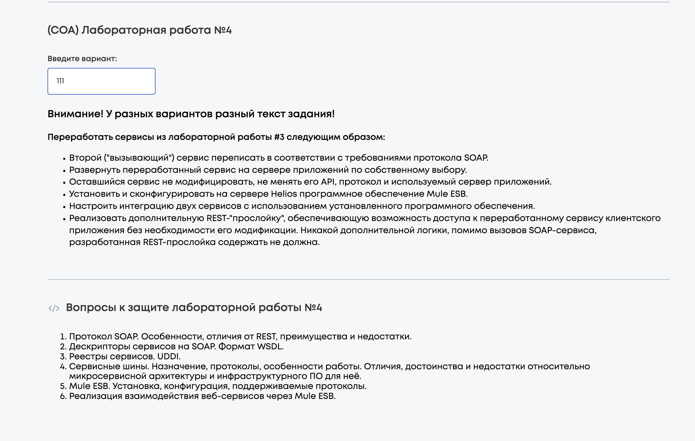

# СОА. Лабораторная работа №4

**Вариант: 111.** Ветка: `lab4`, создана от `lab3`.

## Задание



Переработать сервисы из лабораторной работы №3:

1. Второй («вызывающий») сервис переписать в соответствии с требованиями SOAP.
2. Развернуть переработанный сервис на сервере приложений по собственному выбору.
3. Оставшийся сервис не модифицировать: не менять его API, протокол и сервер приложений.
4. Установить и сконфигурировать Mule ESB на Helios.
5. Настроить интеграцию двух сервисов через Mule ESB.
6. Реализовать REST-прослойку для доступа существующего клиента к SOAP-сервису без изменения клиента. Прослойка не должна содержать дополнительной бизнес-логики.

## Согласованные условия

- На SOAP переводится Starship; SpaceMarine остаётся REST-сервисом на WildFly.
- Клиент сохраняется без изменений. REST-прослойка должна сохранить его контракт: URL, методы, JSON, статусы и ошибки.
- Версия и редакция Mule не заданы преподавателем: выбираются после проверки совместимости с FreeBSD, доступным JDK и ограничениями helios.
- Разрешено останавливать и перенастраивать существующие узлы Starship для ЛР4. Отдельный работающий стенд ЛР3 не требуется.
- Изменения фиксируются коммитами в `lab4` и отправляются в GitHub.

## Архитектура

```text
Клиент ── прежний REST/JSON ──► REST-прослойка
                                     │ SOAP/XML через Mule :27781
                                     ▼
                             Starship + бизнес-логика
                                     │ интеграционный вызов
                                     ▼
                                  Mule ESB
                                     │ прежний REST API
                                     ▼
                                 SpaceMarine
```

Прямые запросы клиента к SpaceMarine сохраняются. HAProxy на 27343 распределяет запросы между REST-прослойками Starship. Каждая прослойка вызывает Mule по HTTPS :27781; маршрут `/starship-1/StarshipService` или `/starship-2/StarshipService` передаёт SOAP endpoint своего узла по отдельному внутреннему HTTPS listener. SOAP endpoint делегирует операции EJB `StarshipBean`; проверка существования десантника идёт через Mule, без прямого fallback к SpaceMarine.

```text
Browser ── HTTPS REST :27343 ── HAProxy
                                  ├─ :27543 REST facade ── Mule :27781 ── HTTPS :27544 SOAP ── Starship EJB
                                  └─ :27643 REST facade ── Mule :27781 ── HTTPS :27644 SOAP ── Starship EJB
                                                                                │
                                                                  HTTP 127.0.0.1:27780
                                                                                ▼
                                                                         Mule Kernel
                                                                                │ HTTPS :27443
                                                                                ▼
Browser ─────────────────────────────── HTTPS :27443 ─────────────── SpaceMarine (без изменений)
```

REST и SOAP используют разные worker-пулы, иначе синхронные REST-запросы могли бы занять все потоки, необходимые вложенным SOAP-запросам. HTTP к Mule доступен только на loopback; внешний и upstream-трафик используют HTTPS с проверкой сертификата.

| Компонент | Адрес / порт | Назначение |
|---|---|---|
| HAProxy | HTTPS 27343 | Прежняя точка входа клиента в Starship |
| SpaceMarine | HTTPS 27443 | Прежний REST API |
| Starship 1 / 2 | HTTPS 27543 / 27643 | REST facade и публичный SOAP endpoint |
| Внутренний SOAP | HTTPS 27544 / 27644, loopback | REST → SOAP без конкуренции за worker |
| Mule | HTTP 27780, loopback | `/health`, `/space-marines/{id}` |
| Mule SOAP | HTTPS 27781, loopback | `/starship-1/StarshipService`, `/starship-2/StarshipService` |
| Consul | HTTP 27500, loopback | Регистрации и health checks исходного стенда |
| HAProxy stats | HTTP 27344, loopback | Состояние backend-узлов |

### SOAP через Mule

В `wildfly-starship-1.properties` задано
`starship.soap.url=https://localhost:27781/starship-1/StarshipService`,
во втором узле — `/starship-2/StarshipService`. Параметр обязателен;
прямого адреса SOAP по умолчанию в REST-прослойке нет.

`mule/src/main/mule/proxy.xml` содержит flows `starship-1-soap-proxy` и
`starship-2-soap-proxy`. Каждый принимает GET/POST, передаёт тело XML,
Content-Type, SOAPAction и query parameters на фиксированный внутренний SOAP listener.
Ответ сохраняет тело, Content-Type и статус, в том числе HTTP 500 с SOAP Fault.
Сетевой сбой upstream даёт 502 от Mule и 503 во внешнем REST API.
Преобразование REST/JSON ↔ SOAP/XML остаётся в `SoapStarshipClient` (CXF).

Один runtime обслуживает SOAP и вложенные обращения EJB к SpaceMarine;
у flows отдельные лимиты параллелизма. HTTPS listener Mule использует
`SOA_KEYSTORE_PATH` (по умолчанию `~/soa/secrets/starship.p12`) и
`SOA_KEYSTORE_PASSWORD`; upstream проверяется по существующему truststore.
Публичный диагностический SOAP endpoint и адрес в сгенерированном WSDL сохранены;
REST-клиент CXF использует явно настроенный адрес Mule, не адрес из WSDL.

### SOAP-контракт

`soap-contract` содержит JAX-WS интерфейс `StarshipPort`, JAXB DTO и checked `StarshipFault`. WSDL генерирует JBossWS/CXF на WildFly. Протокол SOAP 1.1, document/literal wrapped, namespace `urn:soa:starship:v1`.

SOAP-контракт, endpoint и тесты написаны на Kotlin. `@Throws(StarshipFault::class)` сохраняет объявление типизированной ошибки в JVM-сигнатурах. Пространства имён заданы явно в JAXB/JAX-WS аннотациях; Java `package-info.java` не используется. JAXB DTO открыты (`open`), чтобы не добавлять ограничения `final` в XSD, а начальные коллекции изменяемы для XML-десериализации. Контрактный тест сравнивает сформированный WSDL с сохранённым снимком, учитывая пространства имён и порядок XML-полей, но не префиксы и адрес тестового сервера.

Схемы взаимодействия и объяснение роли Mule: [README-LAB4-INTERACTION.md](README-LAB4-INTERACTION.md).

Операции: `list`, `getById`, `create`, `createWithId`, `rename`, `delete`, `board`, `unload`. DTO представлены XML-типами, а не JSON-строками внутри SOAP. Fault detail содержит `status`, `code`, `message`, `details`; REST-прослойка переводит его в прежние HTTP-коды и JSON ошибок.

Прослойка оставляет только транспортную адаптацию: URL/JSON → SOAP DTO, SOAP DTO → JSON, статус создания/удаления и представление ошибок. Проверка существования корабля, уникальности, состава экипажа и работа с БД остаются в EJB.

### Mule

Используется **Mule Kernel 4.11.0 / Java 17 / HTTP connector 1.12.2**. Это самостоятельный Mule runtime, запущенный Java bootstrap без native service wrapper. Приложение: [`mule/src/main/mule/proxy.xml`](mule/src/main/mule/proxy.xml).

Flow сохраняет ответы SpaceMarine, включая 404. Ошибка соединения/TLS/таймаут превращается в 502 на шине; Starship отображает недоступность зависимости в SOAP Fault и REST 503. Остановка Mule не включает прямой обходной маршрут. Локальный `/health` проверяет сам Mule, а не готовность SpaceMarine.

Бизнес-правила и работа с данными кораблей остаются в Starship. Преобразование запросов, ответов и ошибок относится к адаптации протоколов.

## Реализованные части

1. Подобран и проверен Mule Kernel 4.11.0 на FreeBSD / JDK17.
2. Существующий REST-контракт покрыт сквозным smoke test.
3. Реализованы typed WSDL/XSD, SOAP Fault и endpoint с вызовами EJB.
4. Межсервисные GET-запросы проходят через flow Mule.
5. REST → SOAP адаптер сохраняет внешний контракт клиента.
6. Обновлены сборка, deployment, управление процессами и health checks.
7. Проверены SOAP, REST через HAProxy, межсервисные вызовы и отказ Mule.

В Starship восстановлена подсистема `webservices`, добавлены `Standard-Endpoint-Config` и `Standard-Client-Config`. Для HTTPS-only конфигурации явно заданы `wsdl-uri-scheme`, оба WSDL-порта и hostname. `wsdl-port` — метаданные, HTTP listener не открывается. `CONFIDENTIAL` в descriptor закрепляет HTTPS. Конфигурация SpaceMarine не изменена.

Health checks Starship в Consul, HAProxy и control используют WSDL, а не список кораблей: список мог обращаться к Mule для сверки экипажа. Поэтому сбой зависимого сервиса не выключает оба Starship в балансировщике.

### Ограничения helios

Для Starship ограничены MSC bootstrap (1 поток), основной ServerService executor (0–4), Weld (1), REST worker (1 I/O, до 4 task) и SOAP worker (1 I/O, до 2 task). Синхронный клиент Mule использует URLConnection без дополнительного selector/executor. Настройки запуска SpaceMarine оставлены прежними. Это лабораторные ограничения, а не профиль для высокой нагрузки.

У WildFly default ServerService max=1024 не зависит от `ActiveProcessorCount`; одних JVM CPU-флагов недостаточно. [Исходники WildFly Core](https://github.com/wildfly/wildfly-core/blob/31.0.3.Final/server/src/main/java/org/jboss/as/server/ServerService.java).

## Вопросы к защите

1. Протокол SOAP. Особенности, отличия от REST, преимущества и недостатки.
2. Дескрипторы сервисов на SOAP. Формат WSDL.
3. Реестры сервисов. UDDI.
4. Сервисные шины. Назначение, протоколы, особенности работы. Отличия, достоинства и недостатки относительно микросервисной архитектуры и инфраструктурного ПО для неё.
5. Mule ESB. Установка, конфигурация, поддерживаемые протоколы.
6. Реализация взаимодействия веб-сервисов через Mule ESB.

## Статус

Реализованы SOAP Starship, совместимая REST-прослойка, Mule ESB и скрипты развёртывания. На helios запущены оба узла Starship, Mule, прежний SpaceMarine, Consul и HAProxy. Результаты проверки — в [LAB4-REPORT.md](LAB4-REPORT.md).

Клиент: https://se.ifmo.ru/~s409449/soa/lab4/ — точная копия прежней сборки; надпись ЛР3 внутри интерфейса сохранена. Требуются SSH-туннель и доверие браузера к двум сертификатам из `certs/`. Для опубликованного клиента также нужно разрешить доступ к локальной сети. После ручного подтверждения сертификатов и этого разрешения UI-сценарии проверены; найдено ограничение прежнего селектора посадки первой сотней десантников (см. отчёт). Все API-тесты используют сертификаты с включённой проверкой имени хоста.

Публичный WSDL через туннель: https://localhost:27343/starship-soap/StarshipService?wsdl. Снимок контракта сохранён в [docs/starship-soap.wsdl](docs/starship-soap.wsdl).

## Запуск и развёртывание

На ноутбуке нужны JDK 21 для Gradle, Maven для приложения Mule, Python 3 для smoke tests и SSH alias `ifmo`. На helios уже используются WildFly 39.0.1.Final / JDK 21, Mule / JDK 17 и прежняя PostgreSQL. Приватные ключи/пароли остаются в `~/soa/secrets` на helios.

```bash
# Сборка Starship, сборка Mule, доставка и последовательный запуск.
./scripts/deploy-lab4.sh

# Проверить/поднять существующую установку, не пересобирая.
ssh ifmo '~/soa/bin/soa-control.sh status'
ssh ifmo '~/soa/bin/soa-control.sh start'

# В отдельном терминале: доступ к helios через localhost.
./scripts/tunnel-lab4.sh
```

Скрипт ЛР4 не пересобирает и не заменяет EAR SpaceMarine, не меняет его конфигурацию и клиент. Установка рассчитана на существующую базу стенда ЛР3. `setup-lab4-wildfly.sh` дополняет только узлы Starship. Сборка Mule использует `-DskipAST=true` из-за обращения Maven plugin к закрытому Enterprise BOM; реальная проверка XML выполняется Kernel при deployment и smoke tests.

Можно управлять отдельным компонентом:

```bash
ssh ifmo '~/soa/bin/soa-control.sh restart starship-1'
ssh ifmo '~/soa/bin/soa-control.sh stop mule'
ssh ifmo '~/soa/bin/soa-control.sh start mule'
```

Второй аргумент: `spacemarine`, `starship-1`, `starship-2`, `consul`, `haproxy`, `mule`; без аргумента — весь стенд. Супервизор `daemon -r` восстанавливает завершившийся процесс; остановка через control сначала выключает супервизор. После ночного завершения процессов на helios нужно снова выполнить `start`: cron/systemd у студенческой учётной записи нет.

### Проверки через туннель

```bash
python3 scripts/test-lab4-soap.py --ca-cert certs/starship.crt
python3 scripts/test-lab4.py \
  --starship-ca-cert certs/starship.crt \
  --spacemarine-ca-cert certs/spacemarine.crt
```

Сертификаты доверяются отдельно: у двух самоподписанных сертификатов одинаковый Subject, но разные ключи; общий OpenSSL CA bundle может выбирать неверный сертификат. Проверка имени хоста остаётся включённой.

Тесты создают объекты с уникальным префиксом и удаляют только собственные fixtures в `finally`. Вариант отказа шины:

```bash
ssh ifmo '~/soa/bin/soa-control.sh stop mule'
python3 scripts/test-lab4.py \
  --starship-ca-cert certs/starship.crt \
  --spacemarine-ca-cert certs/spacemarine.crt \
  --mule-unavailable
ssh ifmo '~/soa/bin/soa-control.sh start mule'
```

Ожидание: обращения REST-прослойки к SOAP (включая чтение кораблей) — `503`; прямой SpaceMarine продолжает отвечать. Outage-тест выполняет только чтение и не создаёт fixtures. Просмотр журналов:

```bash
ssh ifmo 'tail -50 ~/soa/logs/mule.out'
ssh ifmo 'tail -50 ~/soa/logs/starship-1.out'
```

Строки `MULE_PROXY method=GET path=/space-marines/... status=...` подтверждают прохождение запросов через шину. Строки `MULE_SOAP node=starship-1 method=POST status=200` (либо `500` для SOAP Fault) подтверждают SOAP-маршрут. Тела данных и секреты не логируются.

### Consul после долгого простоя

Для одиночного лабораторного Consul на этом стенде после простоя более недели возникал `server_rejoin_age_max`. При подтверждённой этой ошибке остановить Consul, сохранить `~/soa/consul/data/server_metadata.json` в backup, убрать оригинал и запустить снова. Не удалять Raft-каталог. Это ручное восстановление именно одного сервера, а не универсальная инструкция для рабочего кластера. [Документация HashiCorp](https://developer.hashicorp.com/consul/docs/reference/agent/configuration-file/general).
