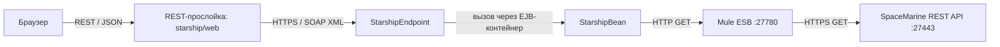
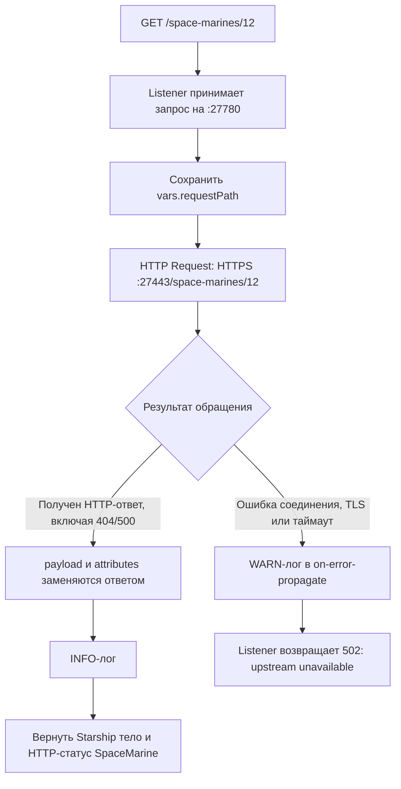

# ЛР4: взаимодействие сервисов и Mule

## Отдельные изображения

- Общая схема компонентов: [PNG](docs/lab4-components.png), [SVG](docs/lab4-components.svg).
- Диаграмма действий при посадке десантника: [PNG](docs/lab4-activity.png), [SVG](docs/lab4-activity.svg).

Исходники Graphviz находятся в `docs/diagrams/`. PNG удобны для просмотра и вставки в отчёт; SVG масштабируются без потери качества.

## Схема взаимодействия

HAProxy и SSH-туннель опущены: здесь показаны программные компоненты и протоколы между ними.

StarshipEndpoint и StarshipBean — два EJB в одном WildFly. Первый адаптирует SOAP-запросы и ошибки, второй выполняет бизнес-правила и работает с данными. REST-прослойка вызывает SOAP по HTTPS, хотя размещена в том же приложении.

## Для чего нужен Mule

Mule — интеграционная платформа. В этой лабораторной её flow принимает запрос Starship, направляет его в SpaceMarine, устанавливает HTTPS-соединение с проверкой сертификата, ограничивает параллелизм, журналирует результат и обрабатывает транспортные ошибки.

Starship знает адрес Mule, а адрес SpaceMarine задан в конфигурации шины. Бизнес-смысл ответа определяет Starship: 200 означает существование десантника, 404 — отсутствие. Прямого обходного маршрута при отказе Mule нет.

REST → SOAP выполняет `starship/web`, поскольку это отдельный адаптер прежнего клиентского API. Mule обслуживает интеграцию двух бизнес-сервисов: Starship → SpaceMarine. Условия задания требуют обе части, но не требуют размещать REST-адаптер в Mule. Технически SOAP-вызов можно было бы реализовать и в Mule; в текущей архитектуре это другой вариант размещения адаптера, а не отсутствующая возможность шины.

Текущий flow использует небольшую часть возможностей Mule: HTTP-маршрутизацию и транспортную обработку. Очередей, преобразования SOAP в REST и оркестрации многошагового бизнес-процесса в нём нет. Для одного такого маршрута вне требований лабораторной внедрение целой ESB могло бы быть избыточным.

## Схема обработки запроса в Mule

Настройка `success-status-code-validator values="100..599"` сохраняет ответы SpaceMarine как результаты HTTP-обмена. Она не превращает 404 в бизнес-успех. Транспортный сбой обрабатывается отдельно.

Starship превращает недоступность зависимости в SOAP Fault, а REST-прослойка — в HTTP 503. При выключенном Mule Starship получает ошибку соединения напрямую, также приводящую к 503. Таймаут чтения Starship и ожидания ответа Mule сейчас равны 5 секундам, поэтому при медленном upstream Starship может прекратить ожидание до получения 502.

## Исходники

- [SOAP-контракт на Kotlin](soap-contract/src/main/kotlin/ru/ifmo/soa/starship/soap/StarshipPort.kt)
- [SOAP endpoint](starship/ejb/src/main/kotlin/ru/ifmo/soa/starship/soap/StarshipEndpoint.kt)
- [Бизнес-компонент](starship/ejb/src/main/kotlin/ru/ifmo/soa/starship/service/StarshipBean.kt)
- [Клиент Mule](starship/ejb/src/main/kotlin/ru/ifmo/soa/starship/client/SpaceMarineClient.kt)
- [Flow Mule](mule/src/main/mule/proxy.xml)
