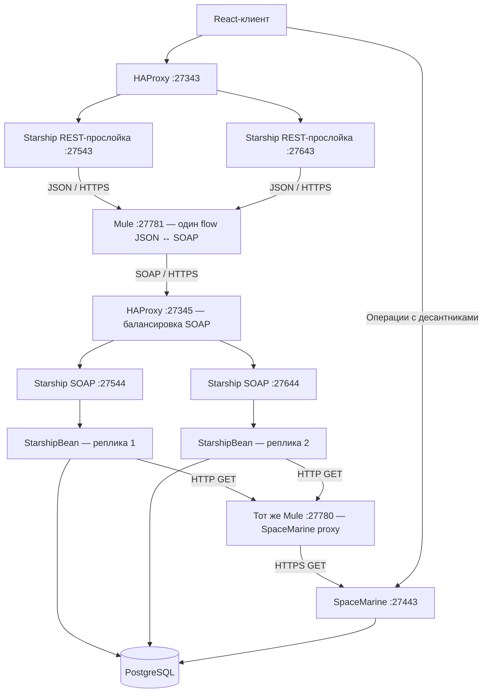
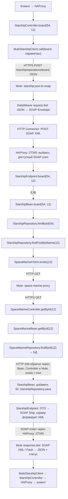

# ЛР4: взаимодействие сервисов и Mule

## Компоненты

## Классы при посадке десантника

Успешный сценарий `POST /starship/54/board/12`. Стрелки внутри репозитория ниже показывают порядок выполнения; результаты вызовов возвращаются вызывающему бизнес-компоненту.

## Что преобразует Mule

REST-прослойка сохраняет прежние URL и проверяет формат HTTP-параметров. Она передаёт операцию и JSON в Mule, а ответ (JSON-байты и статус) возвращает клиенту без SOAP-типов. `SoapStarshipClient` удалён; клиентских зависимостей CXF/JAX-WS в `starship/web` нет. Сервер SOAP на WildFly по-прежнему использует JBossWS/CXF.

Шина выполняет:

1. Принимает JSON по `POST https://localhost:27781/starship/operations/{operation}`.
2. Проверяет операцию по списку восьми разрешённых операций.
3. `transforms/request.dwl` создаёт SOAP 1.1 Envelope и типизированные XML-поля в namespace `urn:soa:starship:v1`; XML writer экранирует строки.
4. HTTP Connector вызывает единый SOAP-вход HAProxy :27345 с TLS-проверкой. Автоматических прикладных повторов нет.
5. `transforms/response.dwl` преобразует SOAP-ответ в JSON, включая массивы, числа, пагинацию и результат высадки. Назначает 201 при создании, 204 при удалении, 200 при остальных успешных операциях.
6. Для SOAP Fault извлекает `detail/StarshipFault`, возвращает JSON ошибки и 400/404/409/422/500/503. Транспортные ошибки дают 503.

Используется **DataWeave + HTTP Connector** на Mule Kernel, без Web Service Consumer и без Enterprise Transform Message. Скрипты подключены через `${file::transforms/...dwl}` в core Set Payload. WSDL описывает контракт, но не загружается шиной во время вызова: соответствие полей явно реализовано в DataWeave и проверяется интеграционными тестами.

Mule отвечает за адаптацию протоколов; бизнес-правила и транзакции остаются в `StarshipBean`. Остановка Mule делает SOAP-зависимые REST-операции недоступными (503). Прямого fallback нет.

## Настройки и исходники

- `starship.mule.url=https://localhost:27781/starship/operations` — одинаково для всех REST-реплик.
- SOAP upstream Mule: HTTPS localhost:27345 → HAProxy → 27544/27644; timeout 25 секунд. REST-прослойка ждёт Mule до 30 секунд.
- SpaceMarine proxy: HTTP 27780 → HTTPS 27443. Отдельные flows допускают вложенный вызов при выполнении SOAP-операции.
- [Конфигурация Mule](mule/src/main/mule/proxy.xml)
- [JSON → SOAP](mule/src/main/resources/transforms/request.dwl)
- [SOAP → JSON и ошибки](mule/src/main/resources/transforms/response.dwl)
- [JSON-клиент REST-прослойки](starship/web/src/main/kotlin/ru/ifmo/soa/starship/client/MuleStarshipClient.kt)

Источником актуальных схем служат Mermaid-блоки выше. Пользовательские `docs/sequence.png` и `docs/components.png` автоматически не перезаписываются.

## Масштабирование SOAP

В Mule один flow `starship-json-to-soap`; количество реплик в нём не задано.
HAProxy имеет два входа: REST :27343 и внутренний SOAP :27345. Это один процесс.
REST- и SOAP-реплики выбираются независимо; состояние хранится в общей БД.
SOAP backend направляет запросы только на отдельные SOAP workers, без возврата в REST.

Список SOAP-портов задаётся `STARSHIP_SOAP_PORTS` при выполнении
`scripts/remote/setup-haproxy.sh` (по умолчанию `27544 27644`). После добавления
нового запущенного SOAP-узла изменить список и применить конфигурацию HAProxy.
Mule и адреса REST-клиентов менять не нужно. Добавление самой REST-реплики
по-прежнему требует регистрации в REST backend HAProxy. Автоматическое
обнаружение узлов через Consul здесь не реализовано.

SOAP backend проверяет WSDL и исключает недоступные узлы. `retries 0`
отключает автоматические повторы SOAP POST, чтобы не повторять изменяющие операции.
